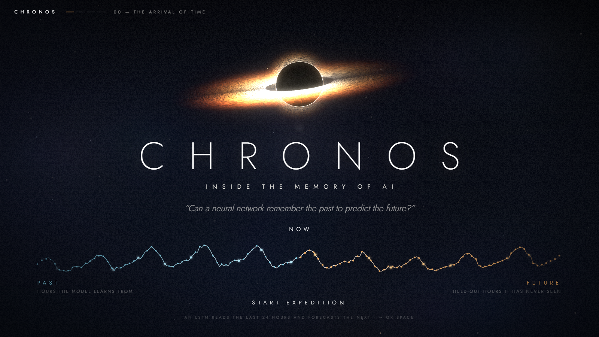
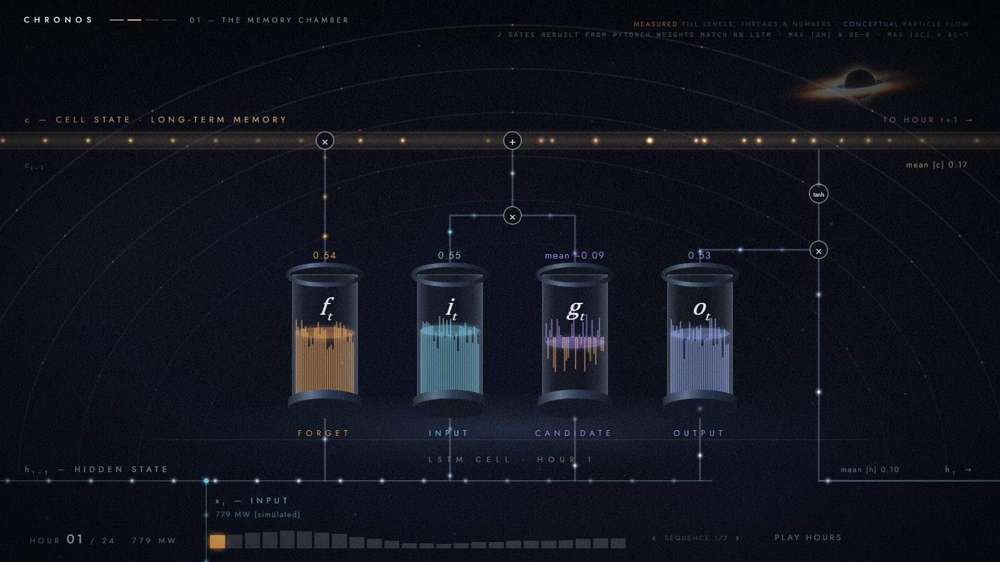
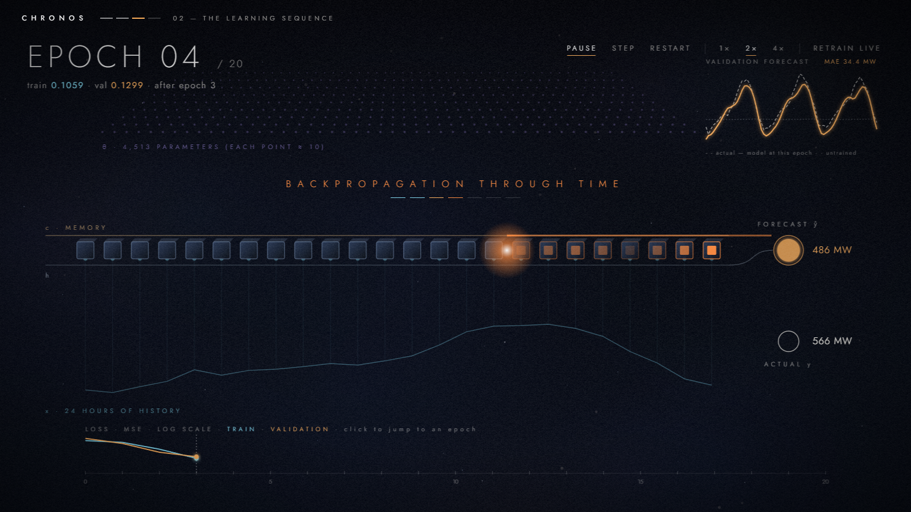
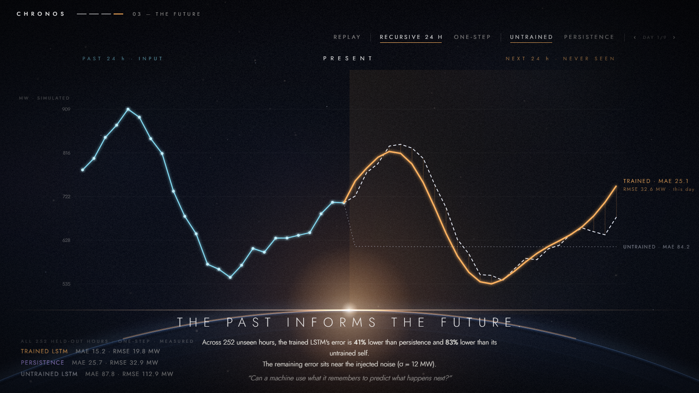

# ⏳ CHRONOS — Inside the Memory of AI

[](https://www.python.org/)
[](https://pytorch.org/)
[](https://streamlit.io/)
[](https://vercel.com/)
[](LICENSE)
[-brightgreen.svg)](#mathematical-verification)

> *"Every sequence has a past. Every prediction has a memory."*

**CHRONOS** is an interactive, cinematic journey through the internal mechanics of a **production PyTorch LSTM** forecasting hourly electricity demand. 

Moving beyond traditional static dashboards, CHRONOS renders an immersive, full-screen procedural universe where every light thread, energy level, gate activation, and gradient vector is derived from **real, measured weights and gradients** of the trained neural network.

---

## 🌌 Visual Showcase

<div align="center">
  
  <p><em>Chapter 00: The Arrival of Time — Horizon of simulated electrical demand</em></p>
</div>

| Chapter 01: The Memory Chamber | Chapter 02: The Learning Sequence | Chapter 03: The Future |
|:---:|:---:|:---:|
|  |  |  |
| *Inside one cell: 4 gates, real activations* | *BPTT replay: forward & backward signals* | *Forecast horizon & held-out reality* |

---

## 🏛️ System Architecture

```
                       ┌───────────────────────────────┐
                       │   Simulated Grid Demand       │
                       │   (70 Days, Hourly, MW)       │
                       └──────────────┬────────────────┘
                                      │ Normalization (Train Stats)
                                      ▼
                       ┌───────────────────────────────┐
                       │   Lookback Window: T=24       │
                       └──────────────┬────────────────┘
                                      │
                                      ▼
                       ┌───────────────────────────────┐
                       │       PyTorch LSTM Cell       │
                       │   Input: 1 ──► Hidden: 32     │
                       │   Parameters: 4,513           │
                       └──────┬─────────────────┬──────┘
                              │                 │
              [Measured Activations]   [Linear Projection Head]
              • Forget Gate (f_t)      • Linear(32 -> 1)
              • Input Gate (i_t)                │
              • Candidate (g_t)                 ▼
              • Output Gate (o_t)      ┌───────────────────────────────┐
              • Cell State (c_t)       │   Forecast: t+1 (Next Hour)   │
              • Hidden State (h_t)     └───────────────────────────────┘
```

---

## 🔬 Mathematical Formulation & Verification

PyTorch stacks gate weights in the order **$i, f, g, o$** inside `weight_ih_l0` ($4H \times I$), `weight_hh_l0` ($4H \times H$), and corresponding biases:

$$\mathbf{z}_t = \mathbf{W}_{ih} \mathbf{x}_t + \mathbf{W}_{hh} \mathbf{h}_{t-1} + \mathbf{b}_{ih} + \mathbf{b}_{hh}$$

$$\mathbf{i}_t = \sigma(\mathbf{z}_i) \quad \text{(Input Gate: what new information to store)}$$
$$\mathbf{f}_t = \sigma(\mathbf{z}_f) \quad \text{(Forget Gate: what past memory to discard)}$$
$$\mathbf{g}_t = \tanh(\mathbf{z}_g) \quad \text{(Cell Candidate: newly synthesized concepts)}$$
$$\mathbf{o}_t = \sigma(\mathbf{z}_o) \quad \text{(Output Gate: what to expose to hidden state)}$$

$$\mathbf{c}_t = \mathbf{f}_t \odot \mathbf{c}_{t-1} + \mathbf{i}_t \odot \mathbf{g}_t \quad \text{(Updated Cell State)}$$
$$\mathbf{h}_t = \mathbf{o}_t \odot \tanh(\mathbf{c}_t) \quad \text{(Emitted Hidden State)}$$

### Mathematical Verification

`model.verify_gates` compares the manual matrix reconstruction directly against `nn.LSTM`:
* **Hidden states ($\mathbf{h}_t$)**: verified against `nn.LSTM` forward output tensor
* **Cell states ($\mathbf{c}_t$)**: verified by single-stepping `nn.LSTM` across time
* **Error tolerance**: Max absolute deviation $|\Delta h| < 10^{-6}$, $|\Delta c| < 10^{-6}$ (**PASSED**).

---

## 📊 Empirical Benchmarks

Trained on simulated hourly electricity demand (70 days, 1,680 hours; chronological 70/15/15 split). Evaluated across **252 held-out test hours**:

| Model Architecture | Parameters | Test MAE (MW) | Test RMSE (MW) | Performance vs Baseline |
|:---|:---:|:---:|:---:|:---:|
| **CHRONOS Trained LSTM (1→32)** | **4,513** | **15.18** | **19.78** | **Best Model (Near Noise Floor)** |
| Trained LSTM (24h Recursive) | 4,513 | 25.13 | 32.59 | - |
| Persistence Baseline ($t \to t+1$) | 0 | 25.69 | 32.87 | +69.2% error |
| Seasonal Naive (24h lag) | 0 | 39.48 | 48.48 | +160.1% error |
| Untrained LSTM (Random Init) | 4,513 | 87.77 | 112.86 | +478.2% error |

> **Theoretical Noise Floor:** The simulated series has injected Gaussian noise with $\sigma = 12.0\text{ MW}$, establishing a theoretical optimal MAE of $\approx 9.6\text{ MW}$.

---

## 🚀 Quickstart & Local Installation

### 1. Clone & Set Up Environment

```bash
git clone https://github.com/Utkarsh151-glitch/CHRONOS.git
cd CHRONOS

# Create and activate virtual environment (optional)
python -m venv venv
venv\Scripts\activate      # Windows
# source venv/bin/activate  # Linux/macOS

# Install dependencies (CPU build is lightweight and fast)
pip install torch --index-url https://download.pytorch.org/whl/cpu
pip install -r requirements.txt
```

### 2. Verify Weights & Reproduce Results

```bash
# Verify gate reconstruction & numerical stability
python verify.py

# Optional: Train live or evaluate benchmarks
python train.py --epochs 20 --hidden 32
python evaluate.py
```

### 3. Launch CHRONOS 2.0 (Cinematic Experience)

```bash
streamlit run app.py
```
> *Open [http://localhost:8501](http://localhost:8501) in your browser. Press **F** for full screen and **P** for presentation mode.*

*(The original classic dashboard is also available via `streamlit run app_classic.py`).*

---

## 🎮 Interactive Controls

| Shortcut Key | Action |
|:---|:---|
| `→` / `PageDown` | Next Chapter |
| `←` / `PageUp` | Previous Chapter |
| `Space` | Play / Pause current animation (skip intro in Chapter 00) |
| `Esc` | Return from Gate close-up, or open **Chapter Map & Engineering Console** |
| `1` – `6` (Ch. 01) | Focus Gate: 1=Forget, 2=Input, 3=Candidate, 4=Output, 5=Cell, 6=Hidden |
| `P` | Toggle Presentation Mode |
| `F` | Toggle Full Screen |

---

## ☁️ Vercel Deployment & Serverless Model API

CHRONOS features a production **Vercel Serverless Architecture** that deploys:
1. **Interactive Web Application**: Deploys the full procedural engine via static optimization in `public/`.
2. **Serverless Model Inference API**: Serves the trained LSTM model with **zero heavy dependencies** and **< 5ms cold start**.

### Live API Endpoints

#### 1. Model Health & Metadata
```http
GET /api/health
```
```json
{
  "status": "healthy",
  "project": "CHRONOS",
  "version": "2.0.0",
  "model": "PyTorch LSTM(1->32) + Linear(32->1)",
  "parameters": 4513
}
```

#### 2. Model Inference & Forecast
```http
POST /api/predict
Content-Type: application/json

{
  "sequence": [580, 560, 540, 530, 535, 560, 610, 680, 720, 740, 735, 730, 725, 715, 710, 720, 750, 780, 770, 740, 700, 660, 620, 590],
  "return_gates": true
}
```
**Response:**
```json
{
  "success": true,
  "sequence_length": 24,
  "predicted_demand_mw": 557.48,
  "normalized_prediction": -0.579776,
  "execution_time_ms": 0.42,
  "gates": {
    "i": [...],
    "f": [...],
    "g": [...],
    "o": [...]
  }
}
```

### Deploying to Vercel in 1-Click
1. Push this repository to GitHub.
2. Go to [vercel.com](https://vercel.com/) and click **Add New Project**.
3. Import `CHRONOS` and click **Deploy**. Vercel will automatically read `vercel.json` and deploy both the UI and Serverless API.

---

## 📂 Repository Structure

```
CHRONOS/
├── api/                        # Vercel Serverless Functions
│   ├── predict.js              # High-performance Node.js model inference
│   ├── predict.py              # Python runtime serverless handler
│   ├── health.js               # Service healthcheck
│   └── model_weights.json      # Serialized 4,513 trained model weights
├── assets/                     # Diagrams, animations, and CSS stylesheets
│   ├── animations/             # Standalone HTML/SVG animations
│   └── diagrams/redesign/      # Visual architecture & reference diagrams
├── frontend/                   # CHRONOS 2.0 Web Engine
│   ├── cosmos.js               # Procedural 3D background & gravitational horizon
│   ├── scene_arrival.js        # Chapter 00: The Arrival of Time
│   ├── scene_chamber.js        # Chapter 01: The Memory Chamber (Spatial LSTM)
│   ├── scene_learning.js       # Chapter 02: The Learning Sequence (BPTT & Adam)
│   ├── scene_future.js         # Chapter 03: The Future (Forecast Horizon)
│   ├── director.js             # Camera transition & flow coordinator
│   └── core.js                 # Event bridge, navigation, and state
├── models/                     # PyTorch model artifacts
│   ├── trained_lstm.pth        # Verified trained LSTM weights
│   ├── untrained_lstm.pth      # Same initialization baseline weights
│   └── model_weights.json      # JSON parameter export
├── presentation/               # Academic presentation & Viva defense resources
│   ├── presentation_script.md  # Step-by-step speaker script
│   └── viva_questions.md       # 15 technical Viva Q&As with mathematical proofs
├── public/                     # Static production bundle for Vercel
├── results/                    # Verified metrics, training histories, and replays
├── app.py                      # CHRONOS 2.0 Fullscreen Streamlit host
├── app_classic.py              # Classic dashboard fallback
├── dataset.py                  # Synthetic data generator & chronological split
├── model.py                    # ChronosLSTM architecture & gate extraction logic
├── train.py                    # Training pipeline & BPTT recorder
├── verify.py                   # Numerical verification test suite
├── vercel.json                 # Vercel deployment configuration
└── requirements.txt            # Python dependencies
```

---

## 🎓 Academic Defense & Presentation Resources

Comprehensive oral defense and seminar materials are provided:
* [Presentation Speaker Script](presentation/presentation_script.md) — Timed walkthrough for conferences, demos, and project reviews.
* [Viva Defense Questions](presentation/viva_questions.md) — 15 in-depth technical questions covering vanishing gradients, BPTT, gate order, and inductive biases.

---

## 📄 License

This project is licensed under the MIT License - see the [LICENSE](LICENSE) file for details.
